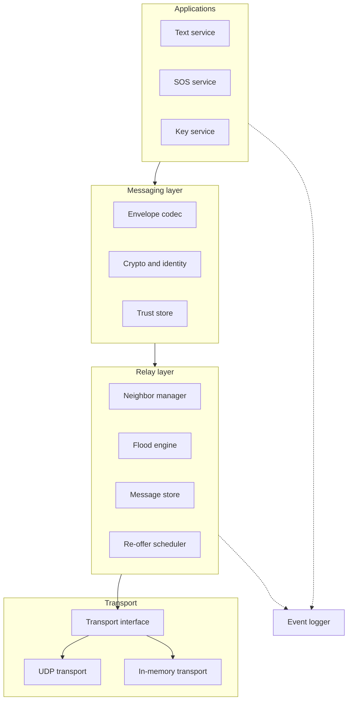
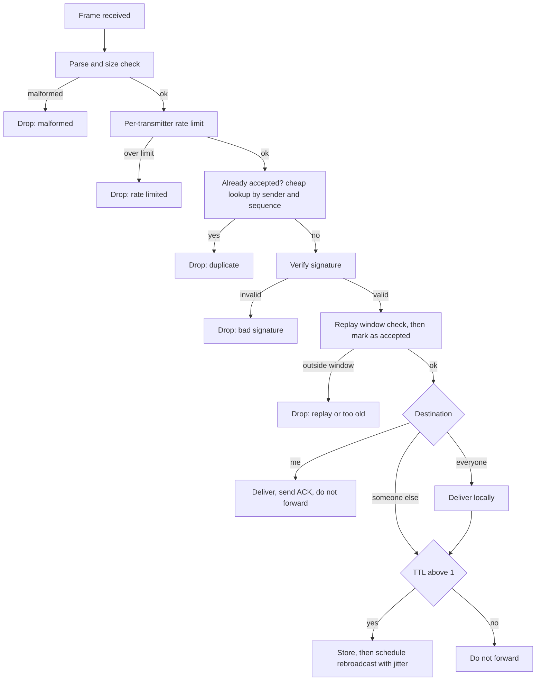
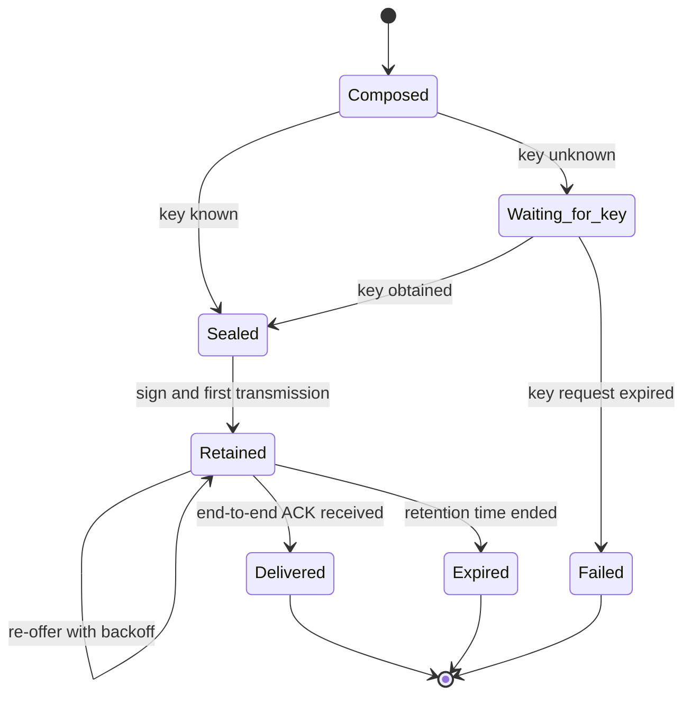
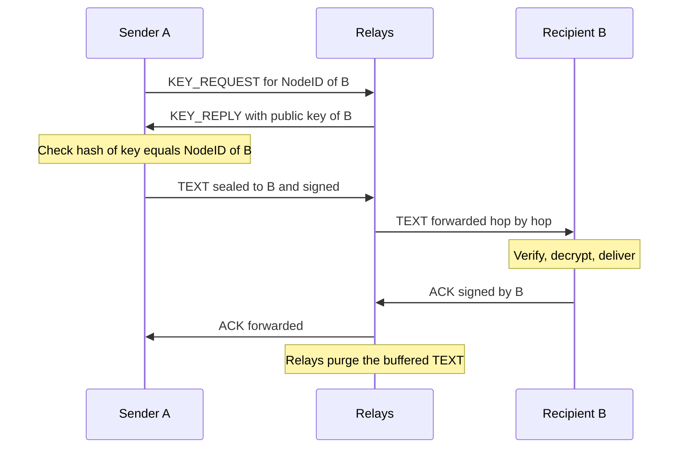
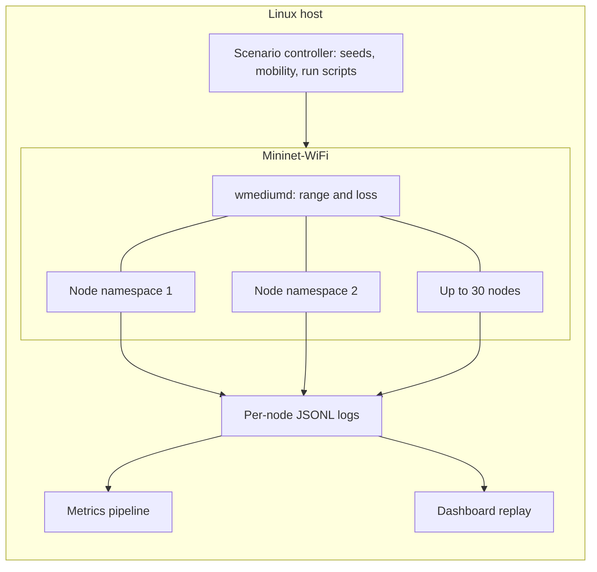

# Lifeline: System Design and Architecture

_Working draft v0.1. Requirement IDs (R1 to R17) refer to the Development Plan. Each design choice is marked **Decided** (already in the proposal), **Proposed** (new in this document, needs team agreement), or **Open** (needs an experiment). Section 10 collects the Proposed and Open items._

## 1. Purpose and scope

This document describes how Lifeline is built: its modules, the messages it exchanges, the algorithms each node runs, the security mechanisms, and the emulation environment used to evaluate it. It covers the emulated system only. A hardware version is future work, but every design choice below is made so that it carries over: nodes are identical, and the radio is hidden behind one interface.

In scope: texts, SOS beacons, neighbor discovery, key distribution, store-carry-forward, the security layer, and the emulation and measurement setup. Out of scope: adaptive routing (PRoPHET, Spray-and-Wait), voice or images, real radios, and a polished user interface.

## 2. Design principles

**Every node is identical.** There is no coordinator, gateway, or special node. A handheld node and a relay-class node run the same program and differ only in configuration (radio range and data rate).

**The radio is an interface.** Everything above the Transport interface knows nothing about Wi-Fi, Bluetooth, or LoRa. This is what lets the same node code run on an in-memory test transport, on UDP inside Mininet-WiFi, and, later, on real radios.

**Messages are small, signed, and self-describing.** Any node can verify any message without having talked to its sender, which is what makes relaying through strangers possible.

**Decisions are local.** A node acts only on what it has heard from its neighbors and what is in its own buffer. No node has a global view.

**Availability beats perfect authentication in a disaster.** Messages from unverified contacts are still delivered, but they are labeled honestly.

**Everything is measurable and repeatable.** Every decision a node makes is logged, and every run is determined by a seed and a scenario file.

## 3. Architecture overview



| Module              | Responsibility                                                                                 | Depends on                                     | Key state                                  |
| ------------------- | ---------------------------------------------------------------------------------------------- | ---------------------------------------------- | ------------------------------------------ |
| Transport interface | Send a frame to all neighbors; receive frames; nothing else                                    | none                                           | none                                       |
| UDP transport       | Implements the interface over UDP broadcast inside Mininet-WiFi                                | Transport interface                            | sockets                                    |
| In-memory transport | Implements the interface in one process with configurable adjacency, loss, and seed, for tests | Transport interface                            | adjacency, RNG                             |
| Envelope codec      | Encode and decode envelopes; enforce sizes; compute the signed byte range                      | none                                           | none                                       |
| Crypto and identity | Key generation, NodeID, sign and verify, seal and open                                         | cryptography library                           | own key pair                               |
| Trust store         | Contacts: NodeID, public key, verified or unverified                                           | Crypto                                         | contact table                              |
| Neighbor manager    | Send HELLO beacons; track who is one hop away; expire silent neighbors                         | Codec, Crypto, Transport                       | neighbor table                             |
| Flood engine        | Receive pipeline, duplicate and replay checks, rate limits, rebroadcast scheduling             | Codec, Crypto, Neighbor manager, Message store | per-sender sequence windows, token buckets |
| Message store       | Bounded buffer with priorities, eviction, and per-message metadata                             | none                                           | buffered messages                          |
| Re-offer scheduler  | Decides when to retransmit buffered messages: timers, new-neighbor encounters, purge on ACK    | Message store, Neighbor manager                | per-message backoff                        |
| Text service        | Compose, seal, retain, and deliver texts; send end-to-end ACKs                                 | Crypto, Trust store, Message store             | retained outgoing texts                    |
| SOS service         | Create and repeat beacons, handle cancel, deliver received beacons                             | Flood engine                                   | active SOS state                           |
| Key service         | Key cache, KEY_REQUEST and KEY_REPLY, QR import                                                | Trust store, Flood engine                      | pending requests                           |
| Event logger        | Append structured events to a per-node JSONL file                                              | none                                           | file handle                                |

Each node is one process with a single event loop (Python asyncio). Timers drive HELLO beacons, rebroadcast jitter, and re-offers. A single-threaded loop keeps behavior deterministic enough to debug.

## 4. Wire protocol

### 4.1 Envelope (Decided in the proposal, refined here)

| Field                   | Size          | Notes                                                                                                         |
| ----------------------- | ------------- | ------------------------------------------------------------------------------------------------------------- |
| Version                 | 1 B           | Starts at 1                                                                                                   |
| Type                    | 1 B           | TEXT, SOS, ACK, HELLO, KEY_REQUEST, KEY_REPLY (KEY_REPLY is Proposed, see D5)                                 |
| Priority                | 1 B           | SOS highest, then ACK, TEXT, KEY messages                                                                     |
| TTL                     | 1 B           | Remaining hops; decremented by each forwarder; **not covered by the signature**                               |
| Message ID              | 8 B           | Derived by the sender as a truncated hash of sender key and sequence number; used for logs and ACK references |
| Sequence number         | 4 B           | Per-sender counter, persisted across restarts                                                                 |
| Sender public key       | 32 B          | Ed25519; NodeID is the first 16 bytes of its SHA-256 hash                                                     |
| Recipient NodeID        | 16 B          | All zeros for broadcast                                                                                       |
| Ephemeral key and nonce | 32 B and 12 B | Texts only                                                                                                    |
| Payload                 | up to 160 B   | Per-type content (below); for texts it includes the 16-byte authentication tag, so about 144 B of plaintext   |
| Signature               | 64 B          | Ed25519 over every field above except TTL                                                                     |

The largest frame is about 332 bytes: it fits one UDP datagram with room to spare. If hardware comes later, a radio with a 255-byte limit (LoRa, for example) would need a compact encoding; that is future work and is why sizes are fixed and small now.

### 4.2 Payloads by type

**HELLO** (one hop only, never forwarded): node class (handheld or relay) and a one-byte protocol capability field. The public key is already in the envelope, which is how neighbors learn each other's keys for free.

**TEXT**: ciphertext sealed to the recipient's public key. The envelope's recipient NodeID is visible to relays, since they need it to route. It leaks who is talking to whom, which is an accepted limitation.

**ACK**: the Message ID being acknowledged, signed by the recipient. Travels back like any other message.

**SOS**: latitude and longitude (4 B each), a status byte (ACTIVE or CANCEL), and an optional short note. Not encrypted, by design.

**KEY_REQUEST**: the NodeID being asked about. **KEY_REPLY**: that NodeID's 32-byte public key. A receiver of a reply checks that the hash of the key equals the NodeID it asked for. This check is the reason NodeID is derived from the key: **the key-to-NodeID binding is self-certifying, so any node may answer, and a lying node is caught.** What remains unverifiable without meeting in person is whether a NodeID belongs to the human you think it does, which is exactly the verified versus unverified distinction.

## 5. Processing

### 5.1 Receive pipeline (the heart of the flood engine)



The order of the steps is a deliberate design, not an accident. **Cheap checks come before expensive ones**: parsing, rate limit, and the duplicate lookup cost almost nothing, while signature verification is the costly step, so an attacker replaying an already-seen message is dropped before it can cost a verification. But the "accepted" mark is written **only after the signature verifies**. If it were written earlier, an attacker could send forged frames claiming a real sender's next sequence number and make a node refuse the genuine one (cache poisoning).

### 5.2 Duplicate suppression and replay protection are one mechanism

For each sender, a node keeps a sliding window over sequence numbers it has accepted. A frame whose sequence number is already marked, or older than the window, is dropped. This single check provides both duplicate suppression (the same flood arriving from several neighbors) and replay protection (an attacker rebroadcasting a captured frame). This simplifies the proposal's separate "message-ID cache" (Proposed, D7). The window size is a parameter, and there is a real design tension here: **a text carried across a long partition arrives long after the sender's later messages, and a small window would reject it as a replay.** The window must be large enough for the delays the evaluation produces (Open, D2).

### 5.3 Rebroadcast scheduling

When a node accepts a message it should forward, it does not transmit immediately. It waits a random jitter, and if during that wait it hears the same message from enough other neighbors, it cancels its own rebroadcast. This is counter-based broadcast suppression, the standard answer to the "broadcast storm": in a dense area, most neighbors hear the same transmission at the same time, and if they all rebroadcast at once they collide and waste airtime. It is also what separates Relay from naive flooding in the evaluation (D3).

### 5.4 Reliability: retention, re-offer, and end-to-end ACK

A text sender keeps the message until it receives the recipient's end-to-end ACK. That makes loss anywhere on the path survivable: if the first flood fails, the sender still has the message. Every relay also keeps a copy in its bounded buffer, and the **re-offer scheduler** retransmits buffered messages in three situations: on a timer with exponential backoff, when a **new neighbor appears** (the store-carry-forward case: a mobile node arrives with messages the neighborhood has not seen), and never again once the end-to-end ACK for that message has been overheard, which purges it. Neighbors that already hold the message drop it as a duplicate (section 5.2), so re-offering is cheap in correctness and costs only airtime. This realizes the proposal's per-hop retries without a separate hop-level ACK frame; overhearing a neighbor rebroadcast the message counts as hop-level confirmation and resets the backoff (Proposed, D4).





### 5.5 Buffers and priorities

The message store is bounded. When full, it evicts the lowest-priority message first and the oldest within a priority. SOS is evicted last, which is the rule the proposal states. Entries also expire after a local retention time: nodes have no synchronized clocks, so age is measured by each holder's own timer.

### 5.6 SOS behavior

A beacon "repeats until cancelled", but an identical repeat would be dropped everywhere as a duplicate. So **each repetition is a fresh message** with a new sequence number and the current coordinates, and cancelling is a fresh SOS with status CANCEL (Proposed, D6). Receivers can show the latest state per sender. Per-sender rate limits stop one node from drowning the network, and the SOS priority keeps legitimate beacons ahead of everything else in every buffer.

## 6. Security design

**Trust model.** A contact is an alias, a NodeID, a public key, and a trust label. Contacts exchanged in person (QR in the real world, a scenario-seeded contact list in emulation) are **verified**. Keys learned from HELLO or KEY_REPLY are **unverified**: accepted on first use, with a warning if the key ever changes. Unverified contacts can still exchange texts.

| Threat                           | Mechanism                                     | Residual risk                                              |
| -------------------------------- | --------------------------------------------- | ---------------------------------------------------------- |
| Forged messages                  | Ed25519 signature over every field except TTL | none for forgery of a known key                            |
| Replay of captured messages      | Per-sender sequence window                    | Messages older than the window are lost (D2)               |
| Relay reads a text               | One-shot sealed encryption to the recipient   | Recipient NodeID and size are visible                      |
| Relay tampers with a text        | Signature plus authenticated encryption       | Relay can still drop the message                           |
| Single neighbor floods           | Per-transmitter token bucket                  | Spoofable transmitter identity outside emulation           |
| Fake SOS flood from one identity | Per-origin rate limit                         | **Sybil attackers with many identities are not stopped**   |
| Dropping (blackhole) relay       | Redundancy from flooding and re-offer         | Measured in the supplementary experiment, not guaranteed   |
| First-contact impersonation      | Verified or unverified labels; QR upgrade     | Unverified contacts can be impersonated at first contact   |
| Key compromise                   | none                                          | No revocation without a central authority                  |
| Location exposure from SOS       | none, by design                               | Public to anyone in range; an accepted emergency trade-off |

TTL is excluded from the signature because relays must decrement it. The consequence is that an attacker can raise a TTL in transit, which lets a captured message travel farther than its sender intended; the sequence window and rate limits bound the damage. This is worth stating in the threat model.

## 7. Emulation and evaluation architecture



Each emulated node is a Mininet-WiFi station running one Lifeline process. The scenario controller creates nodes at seeded positions, applies the mobility model, sets each node's range (about 100 m for handheld, about 500 m for relay-class), configures the loss condition, schedules the message workload, and launches the run. A **run manifest** records scenario file, seed, parameters, protocol variant, and the code commit, so any result can be reproduced.

**Time and logs.** All nodes run on one machine, so they share one monotonic clock. Nodes do not use it for protocol decisions (a real network would not have it), but the logger timestamps every event with it, which is what makes end-to-end latency measurable. Each node writes JSONL events: transmit, receive, drop (with reason), deliver, ACK received, buffer evict, re-offer, and SOS state changes, each with timestamp, node, message ID, type, sender, TTL, and size.

| Metric                            | Computed from                                                    |
| --------------------------------- | ---------------------------------------------------------------- |
| Text delivery ratio               | Texts sent versus texts with an ACK received at the sender       |
| Latency (median, 95th percentile) | Send time to deliver time at the recipient                       |
| Overhead                          | Total transmit events divided by delivered texts                 |
| Hop count over 1 km               | Path length of deliveries between endpoints more than 1 km apart |
| SOS reach and time                | Distinct nodes with a deliver event for a beacon, and when       |
| Maximum per-node load             | Largest transmit count on any single node                        |

**Loss injection.** The proposal specifies a per-link error probability in wmediumd. This is the primary plan, with one caveat to settle in the week-1 spike (Open, D1): wmediumd's fixed per-link error probabilities may not combine with mobility-driven connectivity. The fallback is a **receiver-side loss shim in our own transport**: each receiver independently drops each incoming frame with probability p, drawn from a seeded generator. That is per-receiver and independent, so a broadcast can reach some neighbors and miss others, and it does not depend on Mininet-WiFi features. It is arguably a cleaner experimental control, and it is available the moment the transport exists.

## 8. Initial parameters

These are starting guesses to be tuned in week 5, not requirements.

| Parameter                     | Initial value                                     | Purpose                                         |
| ----------------------------- | ------------------------------------------------- | ----------------------------------------------- |
| HELLO interval                | 2 s with random offset                            | Neighbor discovery rate                         |
| Neighbor timeout              | 3 missed HELLOs                                   | When a neighbor is declared gone                |
| Default TTL                   | 16                                                | Enough for the area's diagonal at 100 m per hop |
| Rebroadcast jitter            | 10 to 80 ms                                       | De-synchronize neighbors                        |
| Counter suppression threshold | 2                                                 | Cancel rebroadcast if heard this many times     |
| Sequence window               | 256 per sender                                    | Replay and duplicate tracking (D2)              |
| Buffer capacity               | 200 messages                                      | Message store bound                             |
| Retention time                | 30 minutes of node time                           | Local expiry                                    |
| Re-offer backoff              | 5 s, doubling, capped at 5 attempts per encounter | Retransmission schedule                         |
| Per-transmitter rate limit    | 20 frames per second                              | Neighbor flood defense                          |
| Per-origin SOS rate limit     | 1 beacon per 10 s                                 | Origin flood defense                            |

## 9. Repository layout and technology

```
lifeline/
  envelope.py  crypto.py  identity.py  trust.py
  transport/   base.py  udp.py  memory.py
  neighbor.py  flood.py  store.py  reoffer.py
  services/    text.py  sos.py  keys.py
  eventlog.py  config.py  node.py
emulation/     scenarios/  run.py  manifests/
analysis/      metrics.py  plots.py
tests/         unit/  harness/  emulation/
docs/          contracts.md  architecture.md  plan.md
```

Python 3 with the `cryptography` package for Ed25519, X25519, HKDF, and ChaCha20-Poly1305; asyncio for the event loop; Mininet-WiFi and wmediumd for emulation; pytest for tests; Git for version control. The package layout mirrors the module table in section 3, so each person's code lives in different files and merge conflicts stay rare.

## 10. Proposed changes and open questions

Decisions marked Proposed or Open, collected in one place. Items D3 to D7 change or clarify wording in the submitted proposal, so decide them before anyone treats the proposal text as final.

| ID  | Item                                                                                                                                                                                              | Status             | Proposed resolution                                                                                                                                                                               |
| --- | ------------------------------------------------------------------------------------------------------------------------------------------------------------------------------------------------- | ------------------ | ------------------------------------------------------------------------------------------------------------------------------------------------------------------------------------------------- |
| D1  | Can wmediumd's per-link error probability be combined with mobility?                                                                                                                              | **Open**           | Test in the week-1 spike; if not, use the receiver-side loss shim (section 7)                                                                                                                     |
| D2  | Replay window versus long partitions                                                                                                                                                              | **Open**           | Window of 256 per sender, tested in the week-3 harness; document the trade-off                                                                                                                    |
| D3  | The proposal defines the baseline as "rebroadcast everything, TTL only". With no duplicate suppression at all, flooding multiplies each message exponentially and the baseline cannot be measured | **Proposed**       | Baseline = flooding with duplicate suppression but immediate rebroadcast, no jitter, no counter suppression, no rate limits, no priorities. Relay adds exactly those. Update the proposal wording |
| D4  | Proposal says "per-hop ACKs and retries"; this design uses re-offer timers, encounter triggers, and overhearing instead of a hop ACK frame                                                        | **Proposed**       | Adopt, and describe it that way in the report                                                                                                                                                     |
| D5  | Key discovery needs a reply message, but the proposal lists only KEY_REQUEST                                                                                                                      | **Proposed**       | Add a KEY_REPLY type                                                                                                                                                                              |
| D6  | SOS "repeats until cancelled" is incompatible with duplicate suppression unless each repeat is a new message                                                                                      | **Proposed**       | Each repeat gets a fresh sequence number; cancel is a fresh SOS with a status byte                                                                                                                |
| D7  | Proposal uses a message-ID cache for duplicates; the sequence window already does this                                                                                                            | **Proposed**       | Dedupe and replay by (sender, sequence); keep Message ID for logs and ACK references                                                                                                              |
| D8  | How to model the lower data rate of relay-class nodes in Mininet-WiFi                                                                                                                             | **Open**           | Check in the spike; candidate: rate-limit that node's interface, or model it in the transport                                                                                                     |
| D9  | How a user discovers a recipient's NodeID beyond QR (a name directory)                                                                                                                            | **Open, deferred** | Out of scope for v1: in emulation, contact lists are seeded by the scenario; KEY_REQUEST resolves NodeID to key                                                                                   |
| D10 | Exchanging summaries on encounter to avoid re-sending messages the neighbor already has                                                                                                           | **Open, deferred** | Do not build unless measurement shows airtime waste from re-offers                                                                                                                                |
