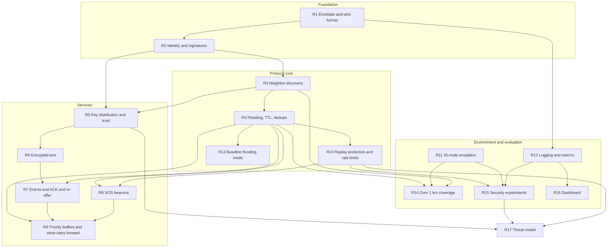
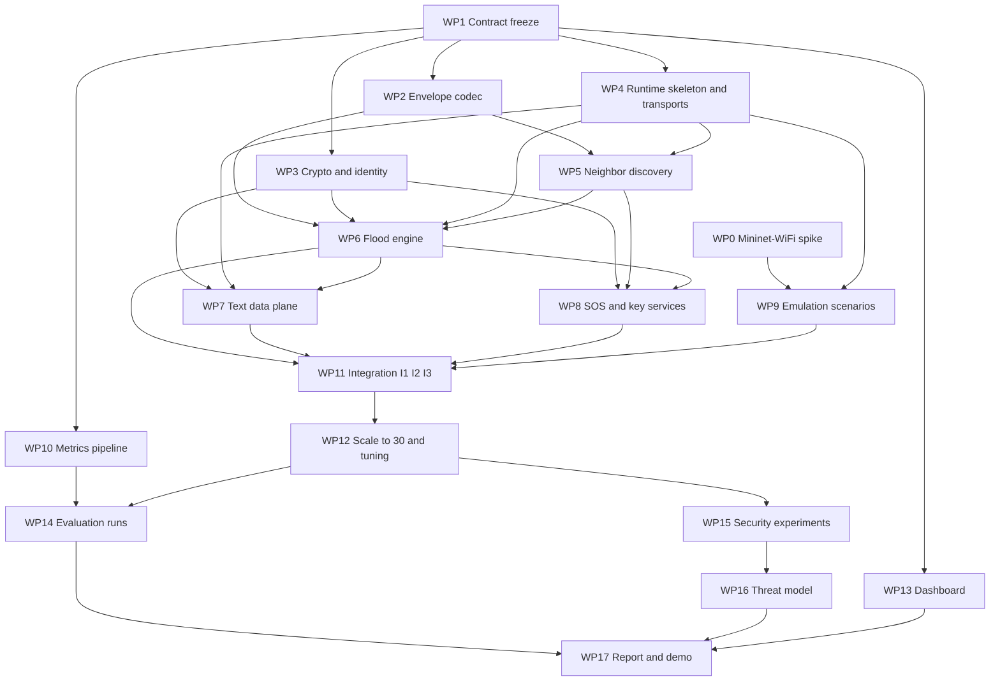

# Lifeline: Development Plan

_Working draft v0.1. Team of three. Companion to the System Architecture document, which defines what each module does; this document defines who builds what, in what order, and when to work together._

## 1. Assumptions and how to read this

Your deadline is not fixed in anything I have, so the plan is written in weeks relative to the start: **8 weeks, including one buffer week**, assuming roughly 8 to 10 focused hours per person per week. If your real deadline is shorter, section 9 says what to cut and in what order, and the dependency graphs in sections 2 and 5 stay valid because they show what depends on what, not how long it takes.

Owners follow the roles in the proposal: **M1 is Furqan**, **M2** and **M3** are your teammates. There is one addition: **M3 owns the runtime skeleton** (the node program, the transports, and the event logger) in weeks 1 and 2. That work is on everyone's critical path, and M3's own slice (SOS, key services, attack experiments, dashboard) is the lightest early on, so this evens out the load. If you assign work differently, nothing below breaks; only the owner column changes.

## 2. Requirements and their dependencies

Every requirement has an ID that the architecture document and the work packages refer to.

| ID  | Requirement                                                                       | Proposal objective |
| --- | --------------------------------------------------------------------------------- | ------------------ |
| R1  | Message envelope and wire format: fixed fields, size-bounded, signed              | O1, O4             |
| R2  | Identity and signatures: NodeID from public key, Ed25519 on every message         | O4                 |
| R3  | Neighbor discovery: signed HELLO beacons, neighbor table                          | O1                 |
| R4  | Flooding with TTL and duplicate suppression                                       | O1                 |
| R5  | Key distribution: keys in HELLO, key cache, KEY_REQUEST, QR import, trust labels  | O4                 |
| R6  | End-to-end encrypted text (one-shot ECIES-style)                                  | O4                 |
| R7  | End-to-end ACK and re-offer for retention-based reliability                       | O1, O3             |
| R8  | SOS beacons: broadcast, repeat until cancelled, top priority                      | O1                 |
| R9  | Priority buffers and store-carry-forward                                          | O3                 |
| R10 | Replay protection and rate limits                                                 | O4                 |
| R11 | Emulated 30-node environment: mobility, relay-class nodes, loss conditions, seeds | O2, O5             |
| R12 | Event logging and metrics pipeline                                                | O5                 |
| R13 | Naive flooding baseline mode                                                      | O5                 |
| R14 | Multi-hop delivery spanning more than 1 km (an acceptance test, not a feature)    | O2                 |
| R15 | Security experiments: dropping relays, SOS flood                                  | O4                 |
| R16 | Dashboard: node positions, topology, message paths                                | POC                |
| R17 | Threat model                                                                      | O4                 |

Read the graph as a spine with branches. The spine is **R1, R2, R3, R4**: you cannot discover neighbors until messages are signed, and you cannot flood until you know your neighbors. Nearly everything else hangs off flooding (R4). Two things are deliberately loose. **R11 and R12 (the environment and the logging pipeline)** depend on the protocol only through agreed contracts, which is why they can be built early and in parallel. **R14 (the 1 km coverage)** is not something you build: it emerges when R3, R4, and R11 work together, so treat it as an acceptance test at integration, not as a task with an owner.

## 3. Collaboration model: integrate through contracts, not through code

The most expensive failure in a three-person project is not a bug; it is two people building against different assumptions and discovering it in week 5. The defense is to agree on four **contracts** in the first three days and then work behind them independently.

| Contract                      | What it fixes                                                                                          |
| ----------------------------- | ------------------------------------------------------------------------------------------------------ |
| C1 Envelope                   | Field layout, sizes, signature coverage, message types and priorities                                  |
| C2 Module interfaces          | The function signatures between modules: Transport, Crypto, Message Store, Flood Engine                |
| C3 Event log schema           | The fields every node writes to its log; metrics and dashboard read only this                          |
| C4 Config and scenario format | How parameters (TTL, jitter, buffer sizes) and scenarios (nodes, positions, loss, seeds) are described |

After the freeze, a contract changes only through a short written note that the people who consume it have agreed to, plus a version bump. The rule of thumb is: **if a decision changes something another person's code reads or writes, decide together; if it only changes the inside of your module, decide alone.**

The second enabler is a **Transport interface with an in-memory implementation**. It lets any module be tested with simulated neighbors, deterministic and in milliseconds, on any laptop, without Mininet-WiFi. This is what makes independent work real: M2 can build and test the whole text data plane before M1's flooding engine exists, by running against a stub.

| Activity                                                                                      | Mode                                     | Why                                                                                       |
| --------------------------------------------------------------------------------------------- | ---------------------------------------- | ----------------------------------------------------------------------------------------- |
| Contract freeze (C1 to C4)                                                                    | **Together**                             | Everyone codes against it, so mistakes here cost the most                                 |
| Module internals: codec, crypto, flood engine, data plane, SOS, key cache, metrics, dashboard | **Solo**                                 | Behind frozen interfaces and the in-memory transport, nobody waits on anybody             |
| Seam: flood engine and data plane (what gets re-offered, when, with what TTL)                 | **Pair, M1 and M2**                      | Both modules decide retransmission behavior and must not duplicate or fight               |
| Seam: HELLO carrying keys and the key cache                                                   | **Pair, M1 and M3**                      | One produces the key announcements, the other consumes them                               |
| Seam: crypto API and trust labels                                                             | **Pair, M2 and M3**                      | Verified versus unverified depends on how keys are validated                              |
| Integration checkpoints I1, I2, I3                                                            | **Together**                             | The first time modules meet; bugs live at the seams                                       |
| Scaling to 30 nodes and parameter tuning                                                      | **Together, M1 leads**                   | TTL, jitter, rate limits, and buffers interact; tuning one alone gives misleading results |
| Evaluation freeze                                                                             | **Together**                             | After it, no protocol change without all three agreeing                                   |
| Evaluation runs                                                                               | **Solo launch, shared script**           | Runs are unattended; whoever has a working Linux environment starts them                  |
| Threat model                                                                                  | **Solo outline, then one joint session** | Each writes the threats in their own slice; the joint session finds gaps between slices   |
| Report                                                                                        | **Solo sections, joint review**          | Writing splits cleanly; consistency does not                                              |

One practical detail: Mininet-WiFi needs Linux. In weeks 1 and 2 only M1 needs it. By week 3, make sure M2 and M3 each get the 5-node scenario running on their own machines, or agree now which machine runs emulation for everyone.

## 4. Work packages

| WP   | Work package                                                                                                                                  | Owner         | Depends on                            | Done when                                                                                                                                                  |
| ---- | --------------------------------------------------------------------------------------------------------------------------------------------- | ------------- | ------------------------------------- | ---------------------------------------------------------------------------------------------------------------------------------------------------------- |
| WP0  | Feasibility spike: Mininet-WiFi with 5 nodes, ad hoc broadcast, loss injection, mobility, relay-class range                                   | M1            | none                                  | 5 nodes exchange UDP broadcasts; measured loss matches configured loss at 0%, 5%, 15%; mobility and loss work together (see architecture open question D1) |
| WP1  | Contract freeze: C1 to C4 written down and tagged v0.1                                                                                        | All           | none                                  | A contracts document exists, all three have signed off in chat or by commit                                                                                |
| WP2  | Envelope codec: encode, decode, size checks, signature-coverage helper                                                                        | M2            | WP1                                   | Round-trip tests pass; malformed input is rejected, never crashes                                                                                          |
| WP3  | Crypto and identity: Ed25519 sign and verify (TTL excluded), NodeID, ECIES-style seal and open, key store                                     | M2            | WP1                                   | Known-answer tests pass; a text sealed by A opens only for B                                                                                               |
| WP4  | Runtime skeleton: node program, Transport interface, in-memory and UDP transports, JSONL event logger, config loader                          | M3            | WP1                                   | Three in-memory nodes pass a signed envelope; logs match schema C3                                                                                         |
| WP5  | Neighbor discovery: HELLO beacons with public key, neighbor table with expiry                                                                 | M1            | WP2, WP4                              | Nodes learn and expire neighbors correctly on the in-memory transport                                                                                      |
| WP6  | Flood engine: receive pipeline, duplicate suppression, TTL, jitter, counter-based suppression, rate limits, replay window, baseline mode flag | M1            | WP2, WP3, WP4, WP5                    | Invariant tests pass (no forward after TTL, no double forward, bad signatures dropped); baseline flag switches behavior                                    |
| WP7  | Text data plane: retention, re-offer schedule, end-to-end ACK, priority buffers, store-carry-forward                                          | M2            | WP3, WP4, WP6 (stub first)            | A text crosses a partition in the harness and the ACK purges buffers                                                                                       |
| WP8  | SOS and key services: SOS generation, repeat, cancel; key cache, KEY_REQUEST and KEY_REPLY, trust labels, QR import                           | M3            | WP3, WP4, WP5, WP6 (stub first)       | SOS reaches all nodes in range of TTL; a missing key is resolved by KEY_REQUEST                                                                            |
| WP9  | Emulation scenarios: topology generator, mobility, relay-class nodes, loss conditions, seeds, run scripts                                     | M1            | WP0, WP4                              | One command runs a seeded scenario and produces per-node logs                                                                                              |
| WP10 | Metrics pipeline: log merge, all metrics, tables and plots                                                                                    | M2            | WP1 (C3)                              | Produces correct numbers from synthetic logs, then from real ones                                                                                          |
| WP11 | Integration checkpoints I1, I2, I3                                                                                                            | All           | see schedule                          | Each checkpoint's demo passes (section 6)                                                                                                                  |
| WP12 | Scale to 30 nodes, tune parameters, pilot runs                                                                                                | All, M1 leads | WP9, WP11                             | 30 nodes run stably; one pilot run per condition and variant completes                                                                                     |
| WP13 | Dashboard: replay of positions, topology, message paths from logs                                                                             | M3            | WP1 (C3)                              | Replays a pilot run                                                                                                                                        |
| WP14 | Evaluation runs: 3 conditions, 3 seeds each, for Relay and baseline                                                                           | All, M2 leads | WP12, WP10                            | All 18 runs complete with logs and a manifest                                                                                                              |
| WP15 | Security experiments: 10% dropping relays, SOS flood with and without rate limits                                                             | M3, with M1   | WP12                                  | Results tables for both attacks under condition C2                                                                                                         |
| WP16 | Threat model                                                                                                                                  | All           | outline from week 2, final after WP15 | Defended and undefended threats listed with evidence                                                                                                       |
| WP17 | Report and demo                                                                                                                               | All           | WP14, WP15                            | Report submitted; demo rehearsed twice                                                                                                                     |

## 5. Build dependency graph

**The critical path** is WP1, then WP4, WP5, WP6, then integration (WP11), then WP12, WP14, WP17. Almost all of it is M1's work, plus M3's skeleton at the start. This is why M3 takes the skeleton, why M2's in-memory harness work matters to M1, and why M1's weekly progress is the number to watch. **Everything off the critical path can slip a few days without moving the end date**: the metrics pipeline (WP10), the dashboard (WP13), and the threat model outline (WP16). They are slack the team can spend helping M1 if M1 falls behind.

## 6. Week-by-week plan

| Week | Goal                                 | Furqan (M1)                                                                        | Member 2                                                                | Member 3                                                            | Together                                                                                                                                                                 |
| ---- | ------------------------------------ | ---------------------------------------------------------------------------------- | ----------------------------------------------------------------------- | ------------------------------------------------------------------- | ------------------------------------------------------------------------------------------------------------------------------------------------------------------------ |
| 1    | Contracts frozen, environment proven | WP0 Mininet-WiFi spike                                                             | WP2 codec, WP3 crypto                                                   | WP4 runtime skeleton, in-memory transport, logger                   | **Days 1 to 3: contract freeze (C1 to C4).** End of week: 3 in-memory nodes pass a signed envelope                                                                       |
| 2    | Discovery and flooding exist         | WP5 HELLO and neighbor table, start WP6                                            | Finish WP3, start WP7 against a stub flood interface                    | UDP transport, start WP8 key cache fed by HELLO                     | **I1:** 5 nodes, signed HELLO, a flooded signed SOS across 2 or more hops (in Mininet-WiFi if the spike succeeded, in memory if not). M2 and M3 get Mininet-WiFi running |
| 3    | Encrypted text works end to end      | Finish WP6: jitter, counter suppression, rate limits, replay window, baseline flag | WP7 core: send, end-to-end ACK, re-offer                                | WP8: SOS repeat and cancel, KEY_REQUEST and KEY_REPLY, trust labels | Pair sessions on the three seams. **I2:** encrypted text across 3 or more hops with key discovery and end-to-end ACK on 5 nodes                                          |
| 4    | Full POC and first 30-node run       | WP9 scenario generator: 30 nodes, mobility, relay-class nodes, loss, seeds         | WP7 priority buffers and store-carry-forward, WP10 metrics on real logs | WP13 dashboard, attacker node variants for WP15                     | **I3:** all four POC demos work on 10 to 15 nodes; first 30-node smoke run                                                                                               |
| 5    | Stable at 30, tuned, pilots done     | Lead scale-up                                                                      | Fix metrics against pilot data                                          | Fix dashboard, finish attackers                                     | **WP12 together.** Pilot: one seed for each condition and variant. **Evaluation freeze at the end of the week**                                                          |
| 6    | Evaluation                           | Monitor run health                                                                 | Lead WP14, run metrics                                                  | Lead WP15                                                           | 18 runs minimum (3 conditions, 3 seeds, 2 variants), plus security runs. Extra seeds toward 5 if time allows                                                             |
| 7    | Analysis and writing                 | Report sections: architecture, environment                                         | Report sections: results, data plane                                    | Report sections: security, threat model                             | Joint threat-model session, demo script, joint review                                                                                                                    |
| 8    | Buffer                               |                                                                                    |                                                                         |                                                                     | Finish the report, rehearse the demo twice, submit                                                                                                                       |

The pilot run in week 5 answers a question this plan cannot: how long one run takes. Measure it, multiply by 18 plus the security runs, and confirm week 6 is enough before the evaluation freeze.

## 7. Working agreements

Use short-lived feature branches off one main branch, and tag each contract version (v0.1, v0.2). A pull request is reviewed by the person who consumes the interface being changed, not by the author's friend: if M1 changes what the flood engine hands to the data plane, M2 reviews. Run the in-memory test suite before merging; it takes seconds, so there is no excuse.

Keep communication light and regular. Each person posts three lines in the group chat every working day (done, next, blocked). Meet twice a week for 30 to 45 minutes, plus the integration checkpoints. Anything blocked for more than a day gets raised at once, because the critical path is short and one stuck person is the whole project stuck.

Testing has four levels. **Unit tests** per module with known-answer vectors for crypto and fuzzed input for the codec. **Harness tests** on the in-memory transport: multi-node scenarios with fixed adjacency, loss, and seeds, checking invariants (a message is never forwarded once TTL is exhausted, a node never rebroadcasts the same message twice, forged and replayed messages are dropped, SOS outranks text in a full buffer). **5-node emulation smoke tests** at each integration checkpoint. **30-node shakedown** in weeks 4 and 5.

For a fair comparison, run Relay and the baseline with the **same seeds** (same mobility and same message schedule), so the difference you measure comes from the protocol and not from luck.

## 8. Risk register

| Risk                                                                              | Early signal                                                    | Mitigation                                                                                                                                                                                                                                                                                                                  |
| --------------------------------------------------------------------------------- | --------------------------------------------------------------- | --------------------------------------------------------------------------------------------------------------------------------------------------------------------------------------------------------------------------------------------------------------------------------------------------------------------------- |
| Mininet-WiFi with wmediumd, ad hoc mode, and mobility does not behave as expected | WP0 spike still failing on day 5                                | Decide by the end of week 1. Fallback A: loss injected by a receiver-side shim in our own transport, connectivity from Mininet-WiFi ranges. Fallback B: plain Mininet with a static topology and scripted link changes. The in-memory harness is a last resort for results, not a replacement the course will likely accept |
| 30 nodes too heavy for a laptop                                                   | Timing jitter in logs, CPU saturated                            | Validate at 5, 15, then 30 in weeks 4 and 5. Fall back to 20 nodes or slower mobility; lower HELLO rate                                                                                                                                                                                                                     |
| Contracts drift between people                                                    | "Works on my branch"; a pull request touches a shared interface | Contract change notes; one owner for the contracts document; contract tests in the suite                                                                                                                                                                                                                                    |
| M1 overloaded on the critical path                                                | An M1 work package slips by more than two days                  | Re-balance at the weekly meeting: M3 takes WP5 sub-tasks, M2 takes the baseline flag                                                                                                                                                                                                                                        |
| Replay window rejects legitimately delayed texts                                  | Late texts vanish in the partition demo                         | Test in the week 3 harness; window size is a parameter; document the trade-off (architecture open question D2)                                                                                                                                                                                                              |
| Serialization or signature bugs between modules                                   | Verification fails only across modules                          | One codec module owns all byte layouts; golden test vectors committed to the repo                                                                                                                                                                                                                                           |
| Scope creep: forwarding intelligence, hardware, a polished UI                     | A new work package appears that is not in section 4             | Anything added must remove something of equal size; the proposal's out-of-scope list decides disputes                                                                                                                                                                                                                       |
| Uneven workload or availability                                                   | One person has nothing to do, or someone is blocked             | Three-line daily status; pair seams; reassign at the weekly meeting                                                                                                                                                                                                                                                         |
| Evaluation takes longer than budgeted                                             | Pilot run duration times 18 exceeds the week                    | Shorten each run (fewer messages) before touching 3 conditions by 3 seeds, which is the course requirement                                                                                                                                                                                                                  |
| Noisy results with 3 seeds                                                        | High variance in the pilot                                      | Add seeds toward 5; present results as illustrative, as the proposal already says                                                                                                                                                                                                                                           |

## 9. If time shrinks

Cut in this order, stopping as soon as the schedule fits: **1)** the dashboard, replaced by static plots from the logs; **2)** extra seeds beyond 3; **3)** the supplementary security experiments; **4)** relay-class nodes, using uniform nodes and more hops; **5)** KEY_REQUEST and KEY_REPLY, leaving QR and HELLO keys only; **6)** mobility and the partition demo, replaced by a static topology with scripted link breaks; **7)** node count from 30 down to 20.

**Never cut:** the envelope and crypto, flooding with the baseline for comparison, encrypted text with end-to-end ACK, SOS, the 3 conditions by 3 runs with real metrics, and the report.

## 10. Definition of done

- [ ] A text crosses at least 3 hops, spanning more than 1 km, is encrypted, and is acknowledged end to end
- [ ] An SOS spreads to every node within TTL, repeats, and stops when cancelled
- [ ] A text is delivered across a partition after a mobile node carries it
- [ ] Forged and replayed messages are rejected, with a log line proving it
- [ ] All 18 evaluation runs completed with a manifest (seed, scenario, parameters, commit hash)
- [ ] Metrics tables and plots for Relay versus baseline under all three conditions
- [ ] Both attack experiments run and reported, with what the defenses did and did not stop
- [ ] Threat model lists what is defended and what is not
- [ ] Report submitted and demo rehearsed twice
